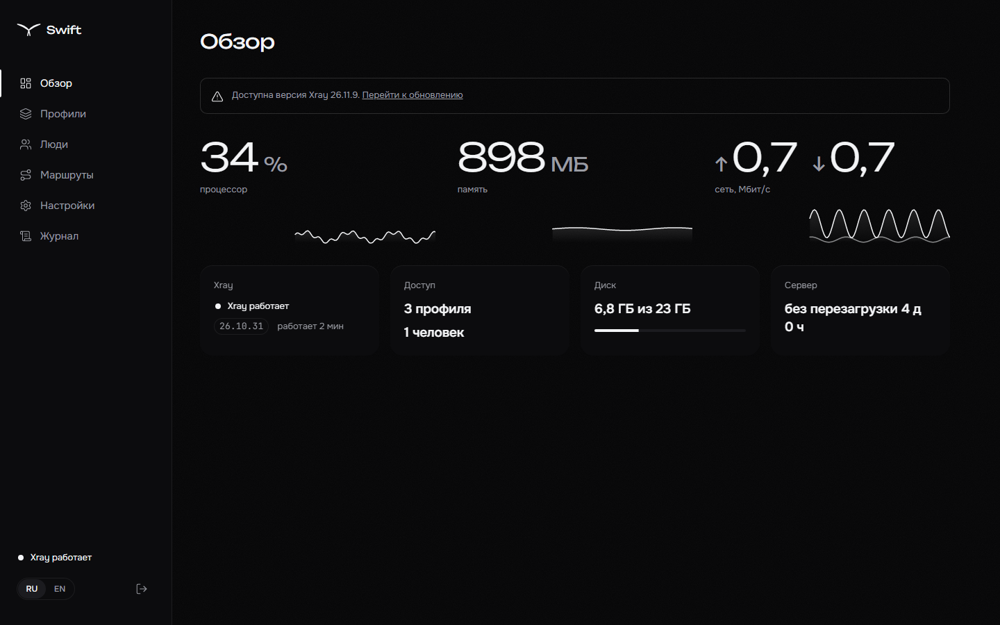
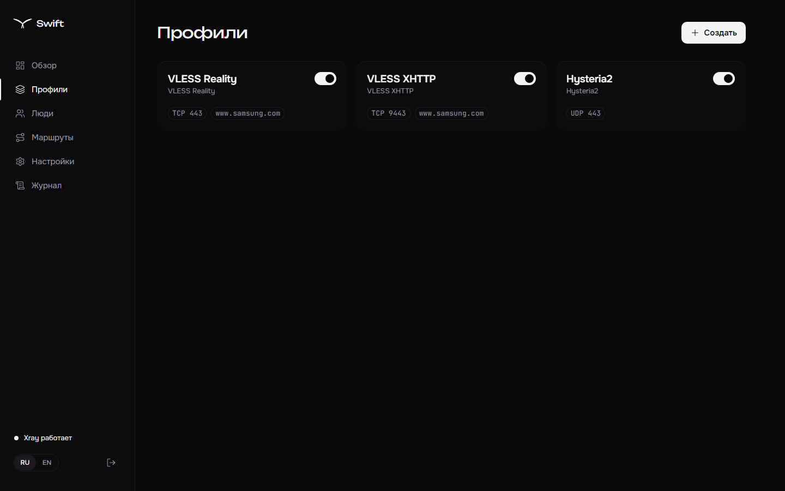
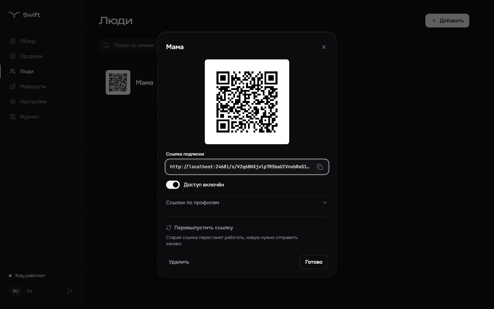
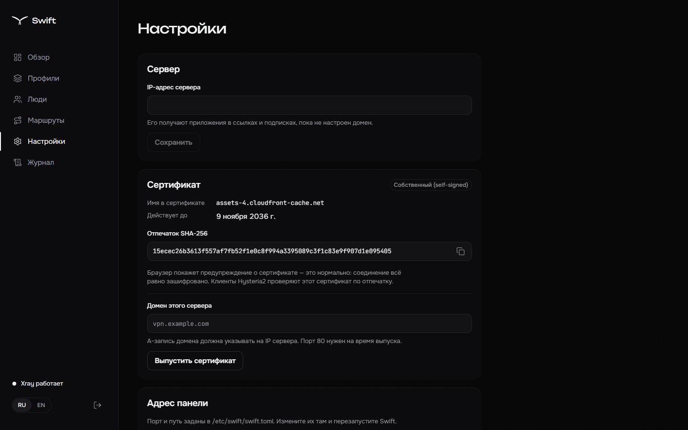
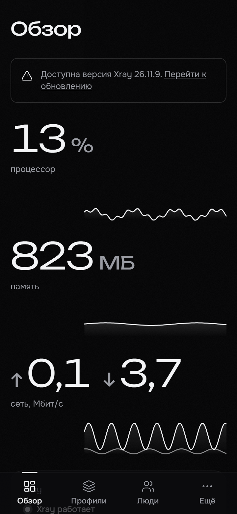
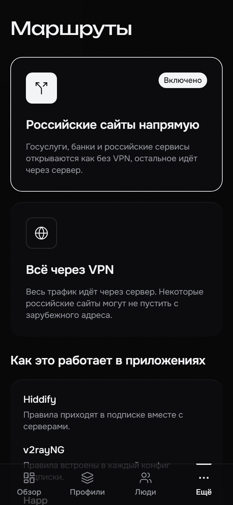
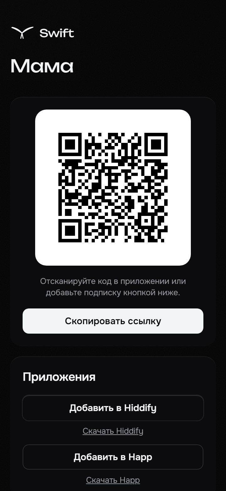

# Swift

[English](README.en.md)

Лёгкая веб-панель для одного VPN-сервера на ядре [Xray-core](https://github.com/XTLS/Xray-core). Поставил одной командой, раздал близким ключи — и всё.



- **Протоколы:** VLESS Reality (TCP + Vision и XHTTP) и Hysteria2 с обфускацией Salamander. Профиль создаётся одной кнопкой: ключи, порт и цель Reality подбираются сами.
- **Люди и подписки:** у каждого человека своя ссылка подписки и QR-код. Подписка подстраивается под приложение — Hiddify, Happ, v2rayNG, v2RayTun. Добавление и отключение — без перезапуска Xray.
- **Российские сайты напрямую:** один переключатель, правила доезжают до приложений через подписку.
- **Сертификаты:** самоподписанный сразу после установки или Let's Encrypt для своего домена с автопродлением.
- **Живой обзор:** процессор, память и сеть без опроса, статус Xray, журнал событий.
- **Обновление Xray из панели:** проверка SHA256, проверка конфига новой версией и автоматический откат, если ядро не поднялось.
- **Один бинарник:** Go без CGO, SQLite внутри, интерфейс встроен. Около 20 МБ памяти.

## Установка

Нужен сервер с Debian 11+ или Ubuntu 20.04+ (amd64 или arm64), systemd и root.

```bash
bash <(curl -fsSL https://raw.githubusercontent.com/vellnico/Swift/main/scripts/install.sh)
```

Установщик спросит про домен (можно пропустить), скачает Swift и Xray с проверкой SHA256, создаст профили VLESS Reality на 443/tcp и Hysteria2 на 443/udp, включит BBR, откроет порты в ufw/firewalld и запустит службу `swift`. В конце он покажет адрес панели, логин и пароль — сохраните пароль, он показывается один раз.

Флаги:

| Флаг | Что делает |
|---|---|
| `--domain <имя>` | сразу выпустить сертификат Let's Encrypt для домена |
| `--address <ip>` | публичный IP, если он не определился сам |
| `--version <тег>` | поставить конкретный релиз |
| `--update` | обновить Swift и Xray; перед этим база копируется в `/var/lib/swift/backup-<дата>.db` |
| `--uninstall [--purge]` | удалить Swift; с `--purge` — вместе с базой и настройками |
| `--no-bbr` | не трогать настройки TCP |
| `--non-interactive` | ничего не спрашивать |

Повторный запуск установщика ничего не ломает: пароль, порты и профили остаются прежними.

## Как пользоваться

1. Откройте адрес панели из итоговой рамки установщика. Браузер предупредит о самоподписанном сертификате — это ожидаемо; выпустите сертификат для домена в «Настройках», чтобы предупреждение исчезло.
2. В разделе «Люди» добавьте человека: появится QR-код и ссылка подписки.
3. Человек открывает ссылку на телефоне — страница подписки предложит добавить её в Hiddify, Happ или v2rayNG одной кнопкой.

| | | |
|---|---|---|
|  |  |  |
|  |  |  |

### Командная строка

```
swift admin show          адрес панели и логин
swift admin reset         новый пароль администратора
swift db backup <файл>    копия базы
swift version             версии Swift и Xray
```

Файлы: бинарник `/usr/local/bin/swift`, Xray и geo-файлы `/usr/local/lib/swift/`, настройки `/etc/swift/swift.toml`, база и сертификаты `/var/lib/swift/`. Журнал службы: `journalctl -u swift`.

## Безопасность

- Панель отвечает только по секретному пути на случайном порту, на всё остальное — пустой 404.
- Пароль хранится как argon2id, после пяти неудачных входов за 10 минут адрес блокируется на 15 минут.
- Cookie `HttpOnly`, `Secure`, `SameSite=Strict`, защита от CSRF, строгая CSP.
- Xray не пишет журнал доступа: ни IP, ни посещённые сайты не сохраняются.

## Разработка

Нужны Go и Node.js.

```bash
make xray     # скачать зафиксированную версию Xray для тестов
make dev      # Go с перезагрузкой и Vite dev server
make lint test build
```

Спецификация и план работ — [docs/SPEC.md](docs/SPEC.md).
