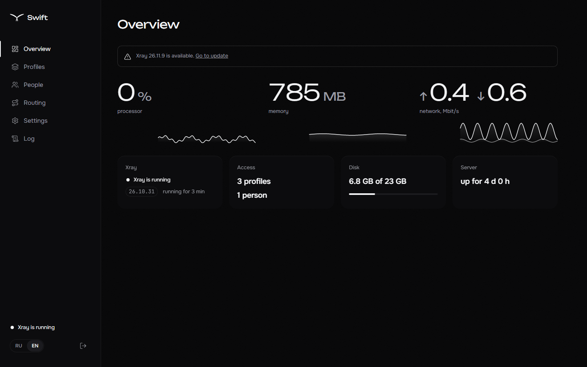
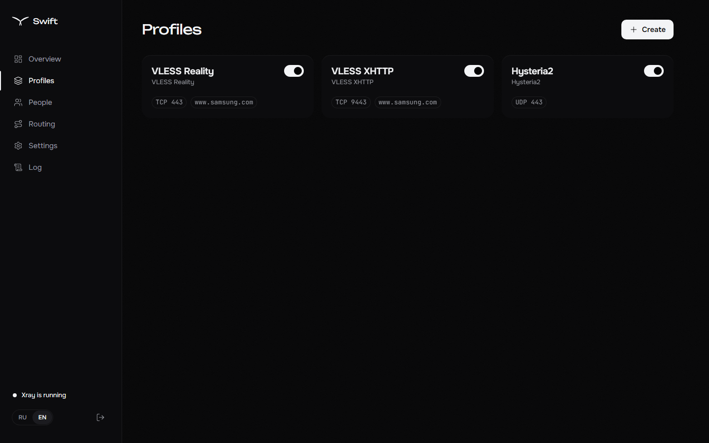
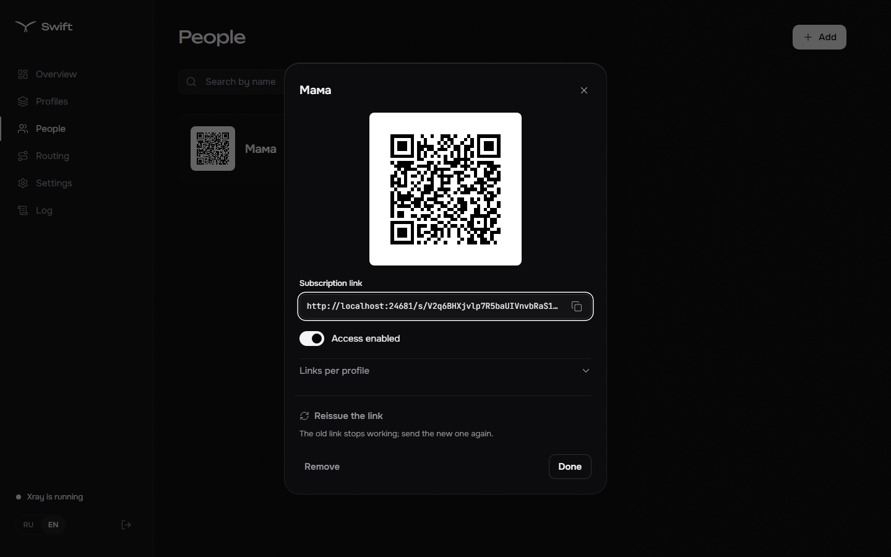
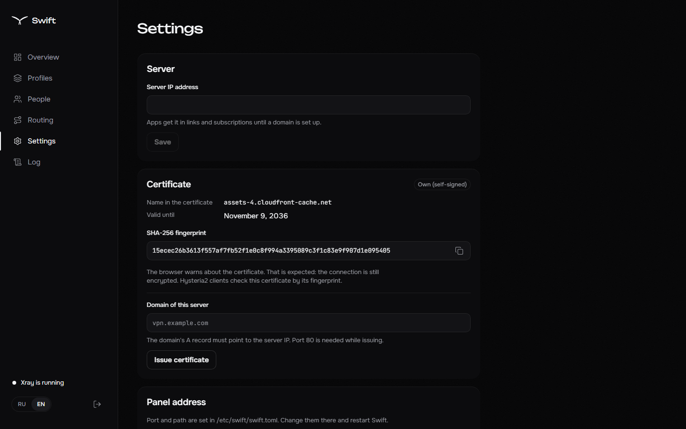
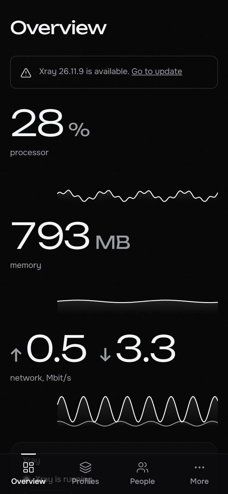
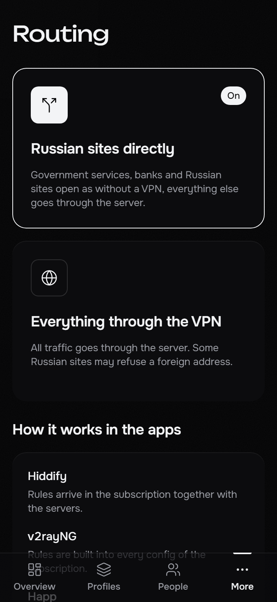

# Swift

[Русский](README.ru.md)

A lightweight web panel for a single VPN server running [Xray-core](https://github.com/XTLS/Xray-core). Install it with one command, hand out keys to family and friends, done.



- **Protocols:** VLESS Reality (TCP + Vision and XHTTP) and Hysteria2 with Salamander obfuscation. A profile is one click away: keys, port and Reality target are picked for you.
- **People and subscriptions:** everyone gets their own subscription link and QR code. The subscription adapts to the app — Hiddify, Happ, v2rayNG, v2RayTun. Adding and disabling people never restarts Xray.
- **Russian sites direct:** one switch, and the rules reach the apps through the subscription.
- **Certificates:** self-signed right after install, or Let's Encrypt for your own domain with automatic renewal.
- **Live overview:** CPU, memory and network without polling, Xray status, event journal.
- **Xray updates from the panel:** SHA256 check, config check with the new version and an automatic rollback if the core does not come up.
- **One binary:** Go without CGO, SQLite inside, the UI embedded. About 20 MB of memory.

## Install

You need a Debian 11+ or Ubuntu 20.04+ server (amd64 or arm64) with systemd and root.

```bash
bash <(curl -fsSL https://raw.githubusercontent.com/vellnico/Swift/main/scripts/install.sh)
```

The installer first asks for the language (English or Russian) — it is used by the installer and becomes the panel's default language. Then it asks about a domain (you can skip it), downloads Swift and Xray with SHA256 checks, creates VLESS Reality on 443/tcp and Hysteria2 on 443/udp, enables BBR, opens the ports in ufw/firewalld and starts the `swift` service. At the end it prints the panel address, login and password — save the password, it is shown once.

Flags:

| Flag | What it does |
|---|---|
| `--lang en\|ru` | installer and panel language without the question; English with `--non-interactive` |
| `--domain <name>` | issue a Let's Encrypt certificate for the domain right away |
| `--address <ip>` | public IP, if it cannot be detected |
| `--version <tag>` | install a specific release |
| `--update` | update Swift and Xray; the database is copied to `/var/lib/swift/backup-<date>.db` first |
| `--uninstall [--purge]` | remove Swift; with `--purge` also the database and settings |
| `--no-bbr` | leave TCP settings alone |
| `--non-interactive` | ask nothing |

Running the installer again breaks nothing: the password, ports and profiles stay as they are.

## Usage

1. Open the panel address from the installer's final box. The browser warns about the self-signed certificate — that is expected; issue a certificate for a domain in Settings to get rid of the warning.
2. In People, add a person: a QR code and a subscription link appear.
3. The person opens the link on their phone — the subscription page offers to add it to Hiddify, Happ or v2rayNG with one tap.

| | | |
|---|---|---|
|  |  |  |
|  |  |  |

### Command line

```
swift admin show          panel address and login
swift admin reset         new administrator password
swift db backup <file>    copy of the database
swift version             Swift and Xray versions
```

Files: binary `/usr/local/bin/swift`, Xray and geo files `/usr/local/lib/swift/`, settings `/etc/swift/swift.toml`, database and certificates `/var/lib/swift/`. Service log: `journalctl -u swift`.

## Security

- The panel answers only on a secret path on a random port; everything else gets an empty 404.
- The password is stored as argon2id; five failed sign-ins within 10 minutes block the address for 15 minutes.
- `HttpOnly`, `Secure`, `SameSite=Strict` cookies, CSRF protection, strict CSP.
- Xray keeps no access log: neither IP addresses nor visited sites are stored.

## Development

You need Go and Node.js.

```bash
make xray     # download the pinned Xray version for tests
make dev      # Go with live reload plus the Vite dev server
make lint test build
```

Specification and work plan: [docs/SPEC.md](docs/SPEC.md).
